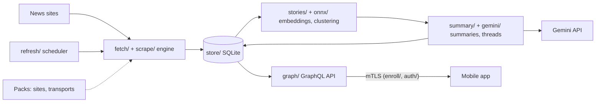

# News server (Go)

A self-hosted Go server that scrapes news sites, groups headlines from different sites into stories with an
embedding model, writes LLM summaries of each story with Gemini, and serves it all to a mobile app over GraphQL with
mutual TLS.

## At a glance

- **Problem:** a news app that scrapes, clusters and summarizes on the phone is slow and drains the battery. This
  server does that work on a home PC, and the phone only reads the results.
- **Scraping:** a config-driven engine (CSS selectors, JSON paths, regex transforms, date formats) ported file by
  file from the app's Kotlin engine. Golden fixtures check parity: a saved page per site must give exactly the
  expected JSON.
- **Story clustering:** bge-m3 sentence embeddings on ONNX Runtime (through purego, no cgo), a similarity graph and
  average-link clustering. `eval-stories` scores the model on 737 labeled headlines and 348 cross-site pairs and
  prints the result next to the app's reference numbers (AUC 0.950, best F1 0.83). The labeled set is in a private
  pack, so the eval cannot be re-run from this repository alone.
- **LLM integration:** Gemini with structured output (a JSON schema) and a daily request budget (400 by default)
  kept under the free tier. Tests run on recorded model answers.
- **Security:** mutual TLS, deny by default. Devices enroll with a one-time code or QR code and get a client
  certificate. Users have roles (admin or user).
- **Tests:** 164 Go test functions in 34 test files. `go test ./...` passes (17 packages with tests, checked
  Nov 12, 2026 on Go 1.26.3, Windows).
- **Size:** about 16,000 lines of hand-maintained Go (generated GraphQL code not counted) and about 4,900 lines of
  tests.

**Stack:** Go 1.26, GraphQL (gqlgen, schema-first), mutual TLS (mTLS), X.509 certificates, SQLite (modernc.org/sqlite,
no cgo), ONNX Runtime, sentence embeddings (bge-m3, multilingual-e5-small), hierarchical clustering, Google Gemini
API, LLM structured output, LLM evals, web scraping, HLS/MP4 video relay, UPnP / NAT-PMP port mapping, BitTorrent DHT
(BEP 44) for discovery, unit / integration / end-to-end tests, golden-file tests, plugin architecture.

## My role

I (Hen Cohen) designed the system, wrote the rules, and review and merge the work. Most of the code was written by
AI coding agents (Claude Code) working under those rules: 55 of 73 commits are authored by the agent, and 13 merge
commits are pull requests I reviewed and merged. My part is the decisions in [docs/plan.md](docs/plan.md), the
standing rules in [CLAUDE.md](CLAUDE.md), and a test harness that makes agent work checkable. Golden fixtures, ported
clustering tests and recorded Gemini answers decide whether a change is right.

## Architecture



One pass, every 10 minutes: read each site's headlines and new articles, embed new headlines, cluster, summarize the
stories that changed within the day's request budget, and archive new rows to plain files. The server ships no
sites. Site configs come from your own folder or from packs compiled in at build time.

The full diagram, key files and the project layout are in [docs/ARCHITECTURE.md](docs/ARCHITECTURE.md).

## Quick start

Requirements: Go 1.26 or newer, and OpenSSL for the certificate scripts.

```bash
git clone https://github.com/chencohensolutions/news-server-core-go.git
cd news-server-core-go

scripts/generate-ca.sh
SERVER_NAMES="myhome.example.org" scripts/generate-server-cert.sh   # names and IPs devices will use
cp config.example.json config.json                                   # then edit public_url, users and sources_dir

go run ./cmd/news-server                   # serves https://0.0.0.0:56399
go run ./cmd/news-server enroll-code hen   # a one-time code and a QR code for the app
go run ./cmd/news-server help              # every command
```

Without your own site configs the server starts, enrolls devices and answers the API, with nothing to read. Stories
need the ONNX models (`news-server models`). Summaries need a Gemini API key. All commands are in
[docs/REFERENCE.md](docs/REFERENCE.md).

## Tests

```bash
go test ./...    # 164 test functions; end to end over real mTLS, plus the example's golden fixtures
```

The tests use a real mTLS server on temporary folders, a fake clock for the scheduler, and recorded Gemini answers.

## Status

Active, started Nov 9, 2026.

- **Done:** mTLS and enrollment, the scraper port with golden fixtures, scheduled fetching into SQLite, story
  clustering with its eval command, and the server part of the GraphQL API.
- **Also built:** Gemini summaries and threads (server part), users and roles, video relay, a plain-file archive
  with restore, router port mapping, and DHT discovery.
- **Not built yet:** the summary-quality eval (judge model, frozen windows) and the app-side screens for summaries.
- **Not started:** running as a service for a week before the phone stops scraping.
- **No CI.** Tests are run locally.

## More docs

- [docs/ARCHITECTURE.md](docs/ARCHITECTURE.md): full diagram, key files, what each milestone built, project layout.
- [docs/REFERENCE.md](docs/REFERENCE.md): all commands, test details, milestone table, packs.
- [docs/plan.md](docs/plan.md): architecture decisions, milestones and trade-offs.
- [docs/authentication.md](docs/authentication.md): mutual TLS, enrollment and roles.
- [docs/source-config.md](docs/source-config.md): the site config schema.
- [CLAUDE.md](CLAUDE.md): rules for AI coding agents working in this repository.

## License

Free for noncommercial use under the [PolyForm Noncommercial License 1.0.0](LICENSE.md). For commercial use, ask for a
separate license. Third-party code, models and data keep their own licenses.
