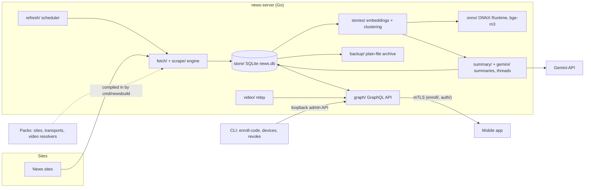

# News server: architecture and design notes

Design detail moved out of the [README](../README.md). Paths in code blocks and inline code are relative to the
repository root.

## What the server does, in more detail

- **Problem:** a news app that scrapes, clusters and summarizes on the phone is slow and drains the battery. This
  server does that work on a home PC, and the phone only reads the results.
- **What it does:** every 10 minutes it reads each configured site, stores headlines and articles in SQLite, groups
  the headlines of the last 7 days into stories (one event reported by two or more sites), asks Gemini for a short
  footnoted article per changed story, and links stories into long-running threads once a day.
- **Scraping engine:** a config-driven scraper (CSS selectors, JSON paths, regex transforms, date formats) ported
  file by file from the app's Kotlin engine. Parity is checked by golden fixtures: a saved page per site must give
  exactly the expected JSON. Schema: [docs/source-config.md](source-config.md).
- **Story clustering:** bge-m3 sentence embeddings on ONNX Runtime (called through purego, no cgo), a similarity
  graph, and average-link clustering. `news-server eval-stories` scores the model on a labeled set of 737 headlines
  and 348 cross-site pairs (83 of them the same event) and prints the result next to the app's reference numbers
  (AUC 0.950, best F1 0.83 for bge-m3; [storyjob.go](../storyjob.go), [stories/eval.go](../stories/eval.go)). The labeled
  set holds real headlines, so it lives in a private pack and not in this repository.
- **LLM integration:** Gemini with structured output (a JSON schema), a daily request budget (400 by default) kept
  under the free tier, a 429 ends the run, a busy model (500/503) is retried. `news-server eval-gemini-grouping`
  scores Gemini's own grouping on the same labeled pairs. Tests run on recorded model answers
  ([summary/testdata/](../summary/testdata/)).
- **Security:** mutual TLS, deny by default. Devices enroll with a one-time code or QR code and get a client
  certificate; the app pins the server's key. Users have roles (admin or user). Details:
  [docs/authentication.md](authentication.md).
- **Tests:** 164 Go test functions in 34 test files; `go test ./...` passes (17 packages with tests, checked
  Nov 12, 2026 on Go 1.26.3, Windows). They include end-to-end tests against a real mTLS server on temporary
  folders, a fake clock for the scheduler, and a local test site for the scraper's politeness rules (gap between
  requests, back-off, `Retry-After`, unchanged pages not downloaded again).
- **Size:** about 16,000 lines of hand-maintained Go (generated GraphQL code not counted) and about 4,900 lines of
  tests.

## How it was built

Most of the code was written by AI coding agents (Claude Code) working under the author's rules. The commit history
shows this plainly: 55 of 73 commits are authored by the agent, and 13 merge commits are pull requests the author
reviewed and merged.

What the author did as the engineer in charge:

- **Decisions and scope.** The architecture, milestones and trade-offs are in [docs/plan.md](plan.md): port
  the Kotlin engine instead of redesigning it, free-tier Gemini only, no cgo, keep the public core free of
  site-specific code.
- **Rules the agents work under.** [CLAUDE.md](../CLAUDE.md) is the standing instruction file: what is the reference
  implementation, what counts as a bug in the port, what may never be added (a paid API key, site configs, real
  headlines), and how tests must be written (real folders and a real mTLS server, not mocks).
- **A test harness that makes agent work checkable.** Golden fixtures decide whether the scraper port is right; the
  app's own clustering tests were ported with the code; the eval command must reproduce the app's numbers; the
  Gemini client is tested on recorded answers. An agent's change either passes these or it does not.
- **Review.** Each milestone arrived as a pull request that I read, ran and merged.

## Architecture diagram (full)



One pass, in order: read every site's headline page, then the articles not yet stored; embed new headlines; cluster;
summarize the stories that changed, within the day's request budget; archive new rows to plain files. Phones then
read `headlines`, `articles`, `stories`, story summaries and `threads` through GraphQL.

Key files:

| Area | Where |
|---|---|
| Scraper engine and politeness | [scrape/](../scrape/), tests in [scrape/extract_test.go](../scrape/extract_test.go), [scrape/engine_test.go](../scrape/engine_test.go), [scrape/fixtures_test.go](../scrape/fixtures_test.go) |
| Scheduler | [refresh/](../refresh/), [refresh/refresh_test.go](../refresh/refresh_test.go) |
| Story clustering | [stories/](../stories/), eval in [stories/eval.go](../stories/eval.go) |
| Summaries, threads, prompts | [summary/](../summary/), [summary/prompts.go](../summary/prompts.go), [summary/summary_test.go](../summary/summary_test.go) |
| Incremental story updates: rules, shadow, replay | [incremental.md](incremental.md), [summary/incremental.go](../summary/incremental.go), [summary/shadow.go](../summary/shadow.go), [summary/replay.go](../summary/replay.go), tests beside them |
| Gemini client | [gemini/gemini.go](../gemini/gemini.go) |
| Gemini grouping eval | [evalgemini.go](../evalgemini.go) |
| GraphQL schema | [graph/schema/](../graph/schema/) |
| mTLS, enrollment, roles | [enroll/](../enroll/), [auth/](../auth/), [middleware.go](../middleware.go) |
| End-to-end tests | [serve_test.go](../serve_test.go), [news_test.go](../news_test.go), [users_test.go](../users_test.go), [video_test.go](../video_test.go) |
| Archive and restore | [backup/](../backup/), [archive.go](../archive.go) |
| Reachability away from home | [portmap/](../portmap/), [discovery/](../discovery/) |
| Pack builder | [cmd/newsbuild/](../cmd/newsbuild/) |

## What each milestone built

Milestone 1, the skeleton:

- **mTLS and enrollment**, copied from journal-server-go (`enroll/`, `auth/`, `middleware.go`): deny by default, only
  `enrollmentPreview` and `enrollDevice` are `@public`, certificates renew with `renewCertificate`.
- **Admin API** on loopback with a token rewritten on every start, and the commands that call it: `enroll-code`,
  `devices`, `revoke`.
- **The site configs** are folders of `<id>/config.json`, from `sources_dir` and from packs: no sites ship with the
  server, you bring them. The schema is [docs/source-config.md](source-config.md); `sources/_example` shows
  it. `sources` lists them.

Milestone 2, the engine port (`scrape/`): the news app's scraper translated file by file. It reads a site's config
(CSS selectors, JSON paths, regex transforms, dates), downloads pages one at a time per site with a gap between them
and a growing pause when a site pushes back, and gives the same output as the app on every saved page of every site
(each source's `fixtures/`). Jsoup's selector and text rules are reimplemented in `scrape/dom`, Java regex through
`regexp2`.

Milestone 3, fetching (`fetch/`, `refresh/`, `store/`): every `refresh_minutes` (10) the server reads every site's
headlines, then the article of each headline it doesn't have yet, newest first, and keeps them in `news.db` (SQLite)
with when each headline was first and last seen. `keep_days` sets how long a headline gone from its site is kept
(`-1`, the example config's value, keeps everything). It reaches the sites with a plain HTTP client that names itself
(`news-server-go (+repo URL)`) unless a site config sets its own user agent. Packs can change how it reaches sites;
see "Packs" in [REFERENCE.md](REFERENCE.md).

Milestone 4, stories (`stories/`, `onnx/`): after each read the server groups the stored headlines of the last
`story_days` (7) into stories, as the app does: each headline embedded with `story_model` (bge-m3 by default; the app's
other choice, multilingual-e5-small, works too) by `story_text` (title + ". " + subtitle), the close pairs kept in a
similarity graph, average-link clustering at `story_strictness` (60, the app's slider), and only groups with two sites
or more. The tokenizer, embedder, graph, clustering and ordering are the app's Kotlin translated file by file, with its
tests. Vectors are kept in `news.db`, so only new headlines (or ones whose subtitle arrived) are embedded. The model
runs on ONNX Runtime through purego, as in journal-server-go; `news-server models` downloads both (587 MB for bge-m3).
Without them the server still reads the sites and says why stories are off.

Milestone 5, the API (`graph/schema/news.graphql`): enrolled devices read `headlines` (all kept, or since a time, for
what changed; optionally some sites only), `article` and `articles` (up to 200 at once), and `stories` (the last
grouping, newest first). The fields are the app's `ArticleSummary` and `Article`; `serverInfo.stories` says whether
stories are on.

Milestone 6, summaries (`summary/`, `gemini/`, `graph/schema/summaries.graphql`, `threads.graphql`): after each
grouping, Gemini writes a short article for each story that changed in the last `summary_hours` (12), in Hebrew,
facts only, every sentence with footnotes naming the source articles. Up to twelve stories go in one request. A
story's next version waits `rewriteMinutes`; each version keeps what the ones before it added, and every version is
kept (`story_versions`, `storyVersions(id)`) with what it changed from the one before, word by word (`changes`). While
a story's next version waits, `stories` gives it the version before (`current: false`). A new story whose sentences
mostly say what a recent one does (the grouping split it off, or grouped the newer reports apart) is written as that
story's next version, under its id, so the app shows one story. A report Gemini finds
unrelated is moved to the closest other story. Once a day Gemini links stories into threads, affairs that run over
months. Grouping by Gemini instead of the embedding model is a setting. The app changes the summary settings
(`setSummarySettings`, admins only). An incremental update of a story, from its version before and its new articles
only, runs in shadow beside the rewrite and is replayed on the archive ([incremental.md](incremental.md)); it writes
nothing the app reads yet.

## Related repositories

- The news app (Kotlin; the reference implementation of the scraper and clustering). Its repository is private.
- journal-server-go: the server this one takes its mTLS, enrollment, port mapping and discovery code from.

## Project layout

```
main.go, serve.go, middleware.go   start-up, routing, identify / gzip / deadlines
admin.go, admincli.go              the loopback admin API and the commands that call it
auth/  enroll/                     config, request identity and @public, enrollment and issuing
sites/                             the sites' configs (sources_dir and the packs') and settings
scrape/                            the engine: configs, extraction, dates, URLs, politeness, downloading
scrape/dom, jsonpath, rx           jsoup-compatible selectors and text, JSON paths, Java-like regex
fetch/  video/                     the HTTP client and video resolvers and relay, with the packs' registries
cmd/news-server, cmd/newsbuild     the plain server; the builder of a server with packs
refresh/  store/                   reading every site on a schedule; the SQLite database, users' choices
reading.go                         wires them into the server and the refresh command
stories/  onnx/                    tokenizer, embedder, similarity graph, clustering; ONNX Runtime through purego
bundle/                            downloads ONNX Runtime and the models, checked by sha256
storyjob.go                        groups stories after each read; the models, stories and eval-stories commands
summary/  gemini/  summaries.go    prompts, summaries, threads, Gemini grouping; the Gemini client
evalgemini.go                      eval-gemini-grouping
incremental.go                     the incremental and eval-incremental commands (summary/incremental.go, shadow.go, replay.go)
backup/  archive.go                the plain-file archive and restore
portmap/  portmapping.go           UPnP / NAT-PMP port forwarding on the home router
discovery/  discover.go            the server's addresses in the BitTorrent DHT, sealed and signed
sitecli.go                         check, extract, fetch
graph/                             public schema and resolvers; graph/admin/ for the admin API
sources/_example                   the config schema's example, with its golden fixtures
scripts/                           CA and server certificates
docs/                              plan.md, authentication.md, source-config.md
```
